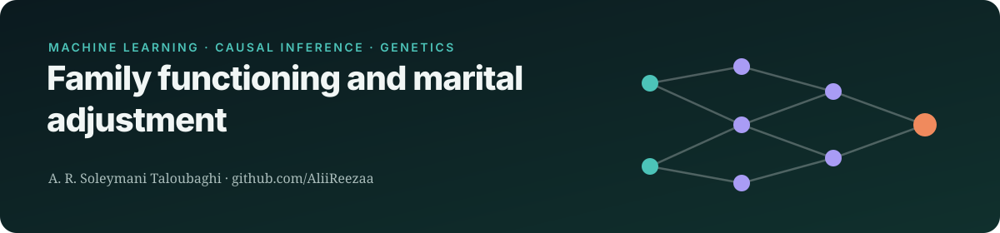
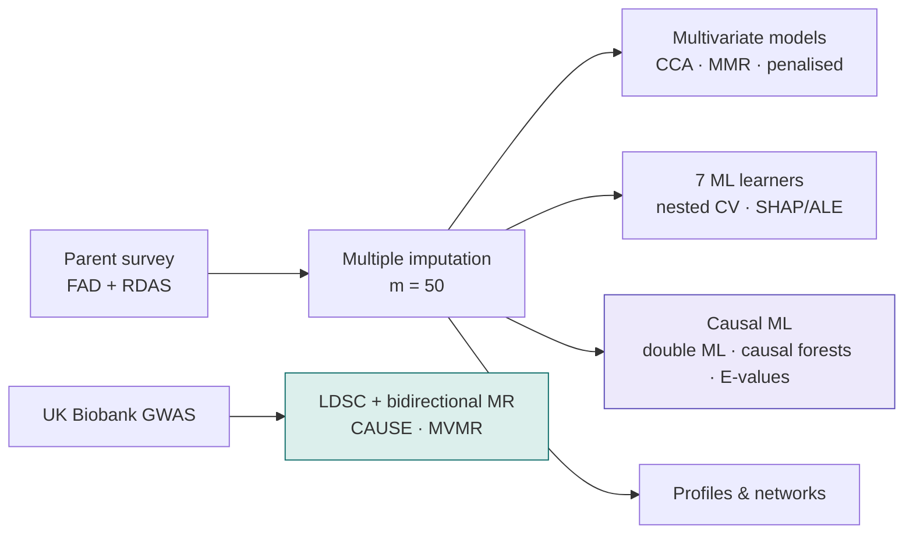

     

> **Status:** two manuscripts drafted
>
> This repository is a public overview of an unpublished study. It shows the research question, design and methods. **Results, data and analysis code are withheld until peer-reviewed publication**, and will be released here at that point.

## Research question
Which dimensions of family functioning drive marital adjustment? Does machine learning improve on classical models? Is there genetic evidence for causal links between psychological traits and relationship satisfaction?

## Study design

## Data sources
| Role | Dataset | Notes |
|---|---|---|
| Survey | Parents in Isfahan, Iran (FAD, RDAS) | participant data is never shared |
| Genetics | UK Biobank family-relationship satisfaction and 10 related GWAS | companion MR study |

## Methods
| Component | Approach |
|---|---|
| Missing data | MICE with 50 imputations; complete-case comparison |
| Classical | canonical correlation, multivariate multiple regression, elastic net, group lasso |
| Machine learning | 7 learners, nested cross-validation, SHAP, ALE, H-statistic |
| Causal | double machine learning, causal forests, PC algorithm, E-values |
| Genetics | LD score regression, bidirectional MR in four tracks, CAUSE, MVMR |

## Why it matters
The study is a template for using ML responsibly in behavioural health. It tests whether complex models actually beat linear ones, and it pairs observational estimates with genetic causal evidence.

## Team & role
Lead analyst **A. R. Soleymani Taloubaghi**, with Prof. Awat Feizi (Isfahan University of Medical Sciences), H. Afshar Zanjani and D. Habibi.

## Reproducibility
- Analysis pipeline written in R and Python, with pinned package versions and a single entry-point script
- Public summary statistics only; no individual-level data is used or shared
- Reported according to STROBE and STROBE-MR

---
Contact: <a href="mailto:alirezasoleymani24@gmail.com">alirezasoleymani24@gmail.com</a> · <a href="https://aliireezaa.github.io">aliireezaa.github.io</a>
